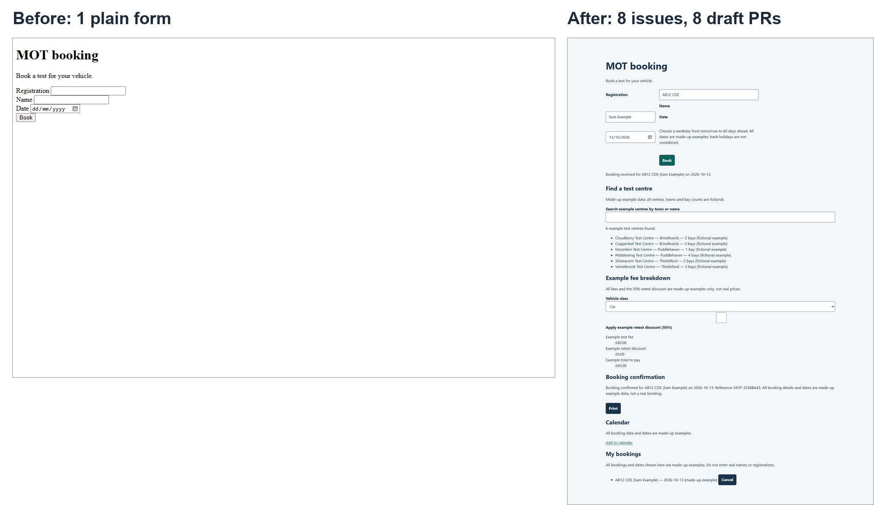

# MOT booking backlog

A deliberately plain MOT booking page, used as a workshop demo of the GitHub Copilot cloud agent working through a backlog of feature requests, each as its own issue and pull request. All data is made up.

## Run it

```
npm start
```

Then open http://localhost:8080. Run the tests with `npm test`.

## Layout

- `index.html`: the page. A booking form and an empty `#app` area that features mount into.
- `src/main.mjs`: handles the form and mounts features.
- `src/features.mjs`: eight numbered slots, one per feature, so features can be developed in parallel.
- `.github/copilot-instructions.md`: the house rules for Copilot.

## The batch: before and after

Eight issues were assigned to the Copilot cloud agent at once. Eight draft pull requests came back, in about ten minutes in this run (one run, not a guarantee). Each issue owns one folder and one line in `src/features.mjs`, so the pull requests merged without conflicts.



|  | Before | After |
|---|---|---|
| Tag | [`before`](https://github.com/alexshaulMS/mot-booking-backlog/tree/before) | [`after`](https://github.com/alexshaulMS/mot-booking-backlog/tree/after) |
| Tests | 2 | 59 |

[Compare `before` and `after`](https://github.com/alexshaulMS/mot-booking-backlog/compare/before...after)

| Issue | Pull request |
|---|---|
| #1 Validate the registration number as people type | #3 |
| #2 Only allow sensible test dates | #5 |
| #4 Add a test centre finder | #7 |
| #6 Show a fee breakdown | #9 |
| #8 Show a booking confirmation with a reference | #11 |
| #10 Add the booking to my calendar | #13 |
| #12 Keep a list of my bookings and let me cancel | #15 |
| #14 Make the page look professional and work for everyone | #16 |

Passing tests are not the same as right. In the finished page the Name and Date labels sit out of line with their fields and the retest checkbox floats away from its label. No test catches either.

Read pull request #15 as a reviewer would: its own description says browser interaction was unverified and CodeQL performed no analysis, and it added an ID counter that issue #12 did not ask for.
